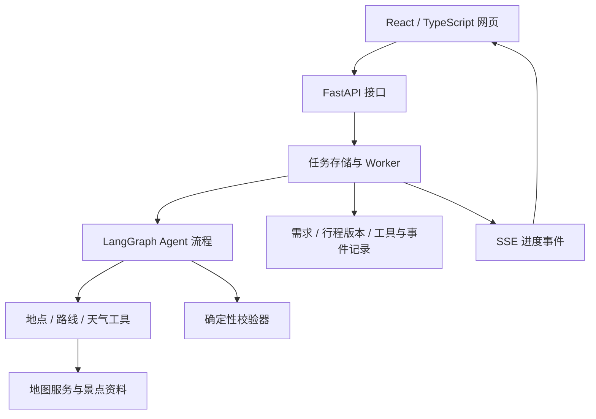

# TripPilot 开发文档

## 1. 文档约定与当前状态

本文件是项目开发依据。下文均为设计方案，勾选项只有在实现并验证后才能标记完成。技术栈版本、外部服务字段、配额、费用与数据使用条件在接入时按官方文档核实。

当前已完成需求和实现路线初稿；未接入真实 API，未整理真实景点数据，未产生评测结果。

每个开发任务记录：解决的问题、实现内容、验收方式、运行证据、遗留问题。需求或技术选择变动时同步更新本文。

## 2. 产品范围

首版：成都、1—5 天，支持需求补问、景点与路线查询、行程生成、程序校验、有限轮次修正、局部修改。

输入：城市、日期、天数、人数、总预算及预算范围、兴趣、节奏、交通偏好、住宿位置或暂定出发区域、每日活动时段。关键条件缺失时补问；可选条件使用的默认值必须展示。

输出：每日活动、地点 ID 与坐标、活动时间、相邻活动交通、费用及估算说明、信息来源与核验时间、未满足条件和待确认事项。

默认建议预算范围：当地住宿、餐饮、门票及市内交通，不含往返交通；在规划前由用户确认。首版不执行支付、预订或承诺实时库存。费用无法核实则标为估算；未知不等于免费。

硬约束：时间不重叠、交通衔接可行、遵守用户确认的活动时段和预算口径。软偏好：兴趣、节奏、景点数量等。信息不足不能宣称已满足全部硬约束。

## 3. 贯穿开发的验收案例

| 编号 | 场景 | 验收要求 |
|---|---|---|
| A01 | 两人成都三天、预算 3000 元、历史美食、轻松 | 补齐日期和起终点等必要信息；地点可核验；时间与交通通过检查；列出费用与未知项 |
| A02 | 一天多个远距离地点、每日最多六小时 | 识别不可行约束，说明原因并提出删减或延时建议，不强行宣称通过 |
| A03 | 修改第二天下午为室内活动 | 保留未受影响安排，避免重复景点，重算相关交通并校验完整行程，保存新版本 |

上述为待执行案例，不是已通过结果。

## 4. 架构与技术选择

- Python、Pydantic：工具实现和输入输出校验。
- LangGraph：需求补问、工具调用、校验反馈与有上限的修正流程。
- FastAPI：后端接口；React / TypeScript：网页和行程展示。
- SQLite：本地原型存储；独立 Worker 与并发阶段迁移 PostgreSQL，配套迁移与并发验证。
- SSE：推送进度；不负责保证后台任务恢复。
- Pytest：自动化验证；Docker：可复现部署。依赖版本在搭建环境时锁定。

首版采用一个 Agent 加工具。模型负责理解、选择和解释；程序负责计算、约束、权限、调用预算和状态写入。初期不加入向量数据库或多 Agent；只有资料规模和实测需求支持时再引入。

## 5. 数据准备

| 数据 | 来源方案 | 缺失处理 |
|---|---|---|
| 地点 ID、地址、坐标 | 地图地点搜索，人工核对匹配 | 不纳入已核验地点 |
| 路线耗时与距离 | 对应交通方式的路线接口 | 标注无法验证，不填编造耗时 |
| 开放规则、票价、预约要求 | 景区官方页面或公告 | 待确认；按日期检查有效性 |
| 游览时长、兴趣标签、室内外 | 人工整理，记录估计依据 | 标为规划参考 |
| 天气 | 可用日期内的天气接口 | 超范围或失败则未知 |
| 餐饮、住宿费用 | 用户预算档位或可核实信息 | 明确估算，不视为实时价格 |

先整理 5 个景点验证字段和流程，再扩展到约 20—30 个。模板在 `data/places_template.csv`。开放规则、票价与预约可分别记录来源。原始公开文本仅按服务及来源允许的方式保存，测试快照与实时信息明确区分。

外部接口勘验记录必须包含：官方文档地址、接口用途、授权方式、关键字段、坐标系、交通方式、配额、超时与错误码、样例响应及核验日期。地图展示与路线计算必须统一或正确转换坐标系。

密钥仅通过环境变量配置；样例、日志、截图和版本库中不包含密钥。真实调用失败时可运行明确标注的模拟模式，不可静默以模拟结果冒充实时数据。

## 6. 数据结构与工具契约

核心结构：

- TripRequest：需求、确认的预算范围、起终点、用户确认的默认值。
- Place：地点 ID、名称、坐标、来源字段与未知项。
- Activity：日期、开始结束时间、地点 ID、费用类型与依据。
- RouteLeg：起终点、方式、距离、耗时、查询时间、交通估计适用范围。
- Itinerary：需求 ID、版本、活动、路线、费用明细、假设和警告。
- ValidationResult：通过 / 不通过 / 信息不足，包含规则编号、活动编号及证据。

工具：`search_places`、`get_place_details`、`get_route`、`get_weather`、`validate_itinerary`。

统一返回：`success`、`data`、`source`、`retrieved_at`、`error`。错误区分参数错误、无结果、限流、超时、认证失败。重试只用于适宜的瞬时错误，设置超时、退避和总调用上限。

## 7. Agent 与校验流程

需求解析 → 必要时补问 → 候选地点检索 → 生成结构化行程 → 查询路线 → 程序校验 → 修正或输出。

修正最多两轮；工具调用次数、模型调用次数和总执行时限均可配置。无法满足约束时返回明确原因和替代建议。工具返回的外部文本作为数据处理，不作为系统指令。

校验规则：地点属于已核验候选；活动时间不重叠；交通缓冲充足；符合每日活动时段；费用按人数、天数和预算范围正确聚合；已知开放与预约规则得到检查；重复地点按用户意图处理。预算检查说明费用覆盖范围，不以缺失费用得出满足预算的结论。

局部修改创建新版本，只变更受影响活动及必要的关联路线，重新验证整个行程。若需要扩大修改范围，向用户说明。

## 8. API、持久化与执行

计划接口：

| 方法与路径 | 用途 |
|---|---|
| POST /trips | 创建任务，支持重复提交标识 |
| GET /trips/{id} | 获取状态与最新行程 |
| POST /trips/{id}/answers | 补充需求，继续等待中的任务 |
| GET /trips/{id}/events | SSE，支持事件序号重连 |
| POST /trips/{id}/revisions | 提交修改，生成新版本 |
| POST /trips/{id}/cancel | 请求取消 |

存储实体：trips、runs、itinerary_versions、tool_calls、events。保存工具参数、状态、耗时、脱敏结果与错误。事件与行程版本可追溯至对应 run。

任务状态：queued、running、waiting_for_input、completed、failed、cancelled。取消为协作式：正在进行的外部请求受超时限制，在步骤边界检查取消。恢复前读取检查点；重复写入和事件发布使用唯一标识约束。Worker 恢复机制在并发阶段再加入租约、心跳及过期执行者校验，并用故障测试验证。

## 9. 实施路线与完成标准

- [ ] M0 需求：确认首版边界、A01—A03、数据字段与缺失策略。
- [ ] M1 数据：5 个核验景点；真实地点和路线查询各成功一次；保存脱敏样例与字段说明。
- [ ] M2 工具：Pydantic 结构、工具适配、模拟响应、超时与错误处理；工具可独立调用。
- [ ] M3 校验：人为错误行程能触发对应规则，未知信息返回信息不足。
- [ ] M4 Agent：命令行跑通完整闭环，补问和修正有上限，保存执行证据。
- [ ] M5 产品：网页输入、地图、历史、局部修改、行程版本和 FastAPI 持久化。
- [ ] M6 可靠性：独立 Worker、SSE、取消、重试、重连、恢复与重复提交控制通过对应测试。
- [ ] M7 交付：独立测试集、基线对照、故障报告、Docker 启动说明和演示。

当前下一步：M0 需求确认与 M1 数据接入。无需等待全部数据准备完成才开发；先以 5 个景点和真实查询验证闭环。

## 10. 评测与简历证据

先建立约 30 条开发任务，另留独立测试任务。后续扩展至 10 类场景、100 条任务是目标规模，不是已有结果。固定案例、输入条件、模型配置、提示词版本、工具快照和评分规则，报告实时工具与固定快照实验的区别。

基线：相同模型、输入与信息条件下直接生成；增强版：加入校验与有限修正。记录各版本实际工具使用、耗时与成本，避免把信息量不同造成的收益都归于 Agent。

指标：地点可核验率、可判定硬约束通过率、未知项数量、任务完成率、人工偏好评分、延迟、模型与工具调用量及可获取的实际费用。每项说明分子、分母与失败处理；重复运行不算独立任务。

故障场景：接口超时、限流、认证失败、无结果、返回缺字段、Worker 退出、SSE 断线、重复提交、修改冲突。测试验证最终状态和业务行为，不以测试数量代替质量。

简历结果仅采用本项目实际记录，不沿用参考项目的 600 次执行、560 次真实调用、589 条一致记录或 127 项检查。

## 11. GitHub 协作方式

README 作为入口，本文作为实施依据。每个里程碑拆成可验收 Issue；代码通过分支提交，并在变更说明中附验证结果。完成后更新勾选项和证据链接。

项目仓库：https://github.com/MLml610/trippilot 。仓库当前为公开；发布与开发状态以实际远程记录为准。
